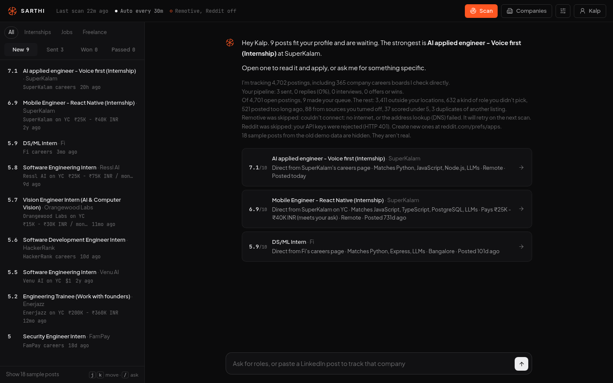
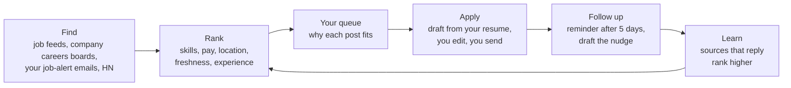
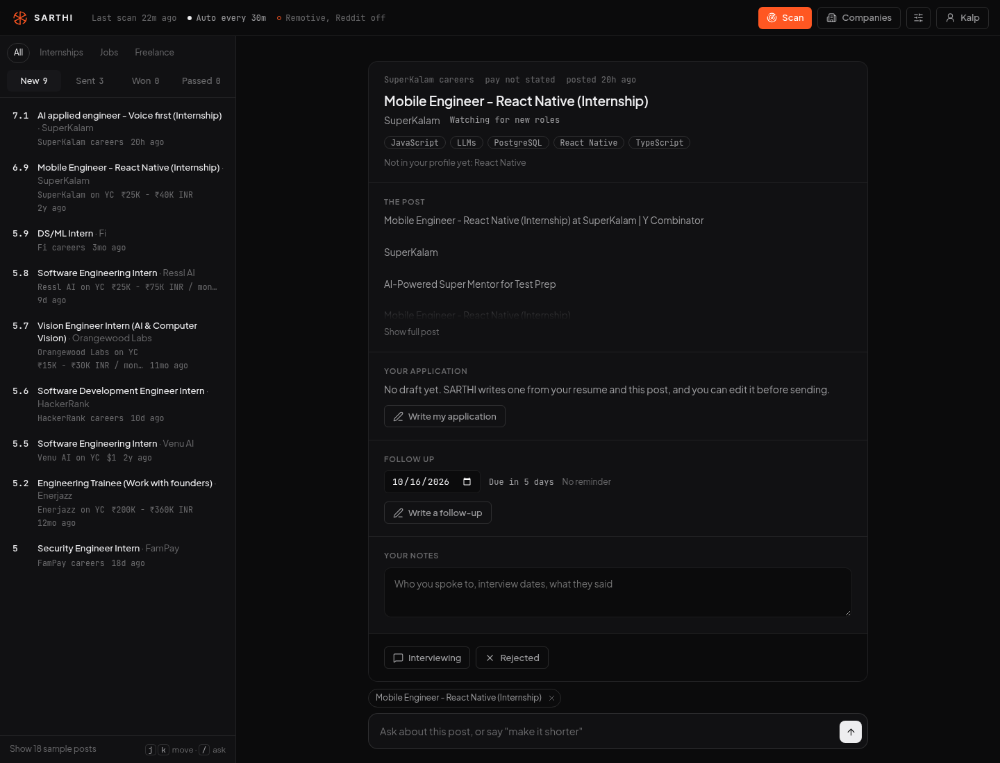
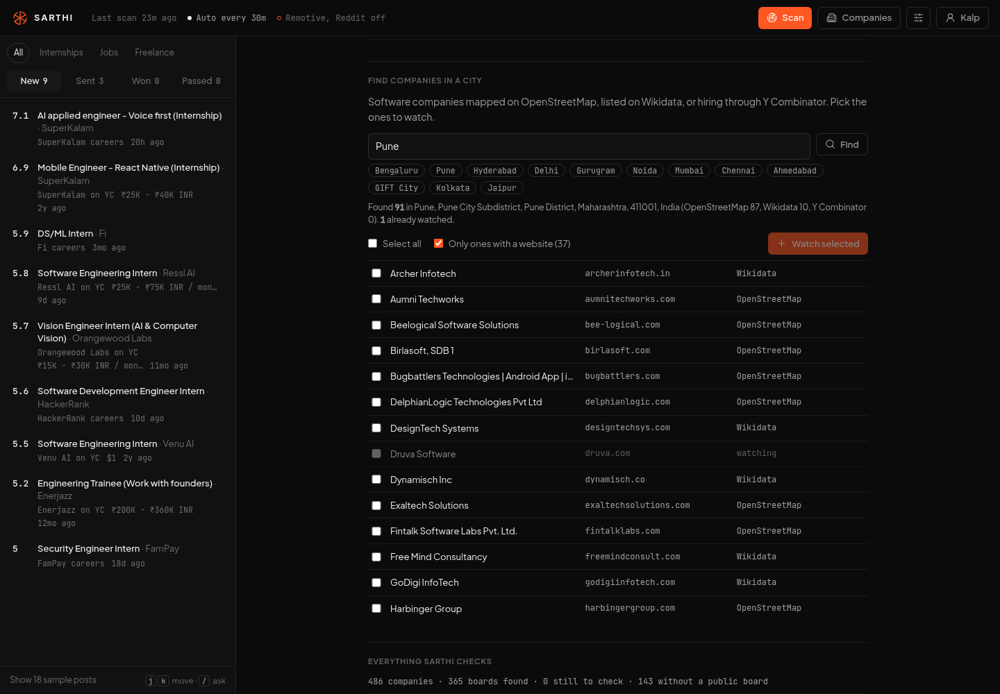

# SARTHI

**An inbox for paid work.** SARTHI finds internships, jobs and freelance gigs that fit you, explains why each one fits, helps you write the application, and reminds you to follow up. You stay in control: nothing is ever sent without your click.



---

## Why it exists

Looking for an internship or your first job usually means:

- **Ten tabs, every day.** Openings are spread across job boards, company careers pages, Hacker News threads and your inbox.
- **Generic applications.** Copy-pasting the same note to every company rarely gets a reply.
- **Forgotten follow-ups.** You apply, wait, and never write back. That's where most chances are lost.

SARTHI puts all of it in one queue, ranked for *you*, with your application and follow-up right next to each post.

## How it works



1. **Find.** SARTHI reads public job feeds, checks companies' own careers boards directly, and reads the job-alert emails LinkedIn, Internshala and Naukri already send you.
2. **Rank.** Every posting gets a 0 to 10 score against your profile. Only good fits reach your queue, and SARTHI tells you in one line why the rest didn't.
3. **Apply.** Open a post, read *why it fits* and *which skills you're missing*, then click **Write my application**. SARTHI drafts it from your real resume; you edit it and send it yourself.
4. **Follow up.** Five days after you apply, the post is flagged *Follow up* and moves to the top of Sent. One click drafts a short, polite nudge.
5. **Learn.** Sources that lead to replies and interviews rank higher over time.



## What you can do

| | |
|---|---|
| **Find work** | Ranked queue of internships, jobs and freelance posts · ask in plain words ("React internship in Pune, ₹15k stipend") · save any search as an alert · auto-scan every 15 min to 12 h |
| **Watch companies** | Add any company to your watchlist and SARTHI checks its own careers board on every scan · **find software companies in any city** (Bengaluru, Pune, GIFT City...) and watch them in one click · paste a LinkedIn hiring post in chat to watch that company |
| **Judge a post** | Score out of 10 with plain reasons · skills the post wants that aren't in your profile · closing-soon posts pinned to the top |
| **Apply** | Application drafted from your resume (never invents experience) · edit freely · one-click email with your resume attached, after a 5-second undo window |
| **Get the job** | Follow-up reminders and drafts · interview prep: likely questions for *this* role, with answers pointing to your real projects, and honest gaps |
| **Keep track** | Notes on every post · status timeline (applied, interviewing, offer) · your reply rate in the briefing · export your applications to CSV |



## Where the jobs come from

SARTHI only uses sources that allow automated access, and says so when one fails.

| Source | What it brings |
|---|---|
| **Company careers boards** | Roles straight from each company's hiring system (Greenhouse, Lever, Ashby, Workable, SmartRecruiters, Recruitee, Workday, YC, plain careers pages). Busy boards are checked more often, quiet ones less. |
| **Your job-alert emails** | Jobs from the LinkedIn, Internshala and Naukri alerts in your Gmail, read-only. SARTHI never opens those sites. |
| **Public job feeds** | SimplifyJobs, The Muse, Unstop, Remotive, Remote OK, Jobicy, Himalayas |
| **Freelance threads** | Hacker News "Who is hiring?" and "Seeking freelancer?" (and Reddit, if you have approved API keys) |
| **City company finder** | Software companies from OpenStreetMap, Wikidata and Y Combinator's public list |

**Never used:** scraping LinkedIn, Internshala, Naukri, Wellfound, Indeed or Google Maps. Their terms forbid it, and it can get your account banned.

## Promises

- **Nothing is sent without your click.** Every email waits 5 seconds so you can undo, there's a daily cap (default 20), and the same address is never emailed twice for the same post.
- **Nothing is invented.** Drafts and interview prep only use what's in your resume. Unknown pay says "pay not stated". A source that fails is shown as failed, not hidden.
- **Your data stays on your machine.** Everything is stored in a local SQLite file. Only the sources above, the AI drafting calls (Gemini) and the emails you send go over the network.

---

## Quick start

You need **Python 3.10+**. It takes about 10 minutes.

**1. Install**

```bash
git clone https://github.com/kalp-cg/Ai-Job-Finder.git
cd Ai-Job-Finder
pip install -r requirements.txt
cp .env.example .env
```

**2. Add your keys to `.env`.** All of them are optional; SARTHI tells you what each missing one turns off.

| Key | What it unlocks | Where to get it |
|---|---|---|
| `GEMINI_API_KEY` | Application drafts, interview prep, follow-ups, lead scoring (otherwise plain templates) | Free at [Google AI Studio](https://aistudio.google.com/app/apikey) |
| `SMTP_USER`, `SMTP_PASSWORD` | One-click email applications **and** reading your LinkedIn/Internshala/Naukri alert emails | A Gmail [App Password](https://myaccount.google.com/apppasswords) (needs 2-step verification), not your normal password |
| `REDDIT_CLIENT_ID`, `REDDIT_CLIENT_SECRET` | Freelance posts from Reddit | Reddit now approves API access case by case; skip it and turn Reddit off in Settings |

**3. Run**

```bash
python main.py web
```

Open **http://localhost:8000**.

**4. First five minutes in the app**

1. **Profile** (top right): drop in your resume PDF. SARTHI reads your skills and links from it. Set what you're looking for: internship or job, cities, expected pay.
2. Click **Scan**. The first scan takes 2 to 3 minutes.
3. **Companies**: search your city and watch the companies you'd like to work at.
4. On LinkedIn, turn on **job alerts** (email, daily) for the roles you want. SARTHI picks them up from your inbox on every scan.
5. **Settings**: turn on auto-scan.

## A 15-minute daily routine

1. Open SARTHI. With auto-scan on, the queue is already fresh.
2. Check **Sent** first: anything tagged *Follow up* gets a short nudge.
3. Go through **New** with `j` / `k`. Pass on what doesn't fit; open what does.
4. For each good one: **Write my application**, edit it, then **Send email** or **Copy & open** their form.
5. When someone replies, move the post to *Interviewing* and click **Prep for interview**.

---

## Your files

| File | What it is |
|---|---|
| `config/profile.yaml` | Your name, links, skills and search preferences. Edited from the Profile page. |
| `data/resume.md` | The text SARTHI writes from. Created when you upload your resume. |
| `data/portfolio.md` | Short case studies of your real projects, used in freelance replies. |
| `config/companies.yaml` | A starter list of Indian tech companies to watch. Add your own. |
| `data/assistant.db` | Everything SARTHI has found and everything you've done (local, git-ignored). |

> [!WARNING]
> If your fork is public, keep your resume, profile and portfolio out of git, or anyone can read them.

## For developers

```
main.py                  CLI entry point: web, chat, run, leads, jobs, digest, track
src/
  core/                  SQLite storage (db.py), Gemini wrapper (llm.py), terminal digest
  opportunities/
    sources.py           Public job feeds
    companies.py         Careers-board discovery and adaptive polling
    discover.py          City company finder (OpenStreetMap, Wikidata, YC)
    email_alerts.py      Job-alert emails over IMAP, read-only
    ranking.py           Scoring and filtering, no AI calls (thousands of posts in ~50 ms)
    refresh.py           Runs due sources and updates alerts
    mailer.py            Sends one email on your click
  leads/                 Hacker News / Reddit freelance leads: extract, score, draft
  web/
    app.py               FastAPI routes
    agent.py             Drafts, follow-ups, interview prep, resume parsing
    static/              The web app (plain HTML, CSS and JavaScript)
tests/                   unittest suite, runs against a throwaway database
```

**Run the tests** (no network, never touches your data):

```bash
python -m unittest discover -s tests
```

<details>
<summary><b>How a posting is scored</b></summary>

```
score = 10 × relevance^0.7 × (0.55 + 0.45 × fit) × (0.7 + 0.3 × source trust)
```

- **Relevance:** half "is this your kind of role" (from the title), half skill and keyword overlap (BM25). A fresh, well-paid role that isn't for you can't score well.
- **Fit:** pay against what you asked for, location, freshness (10-day half-life) and experience asked.
- **Source trust:** starts from a prior (company careers 1.0, YC 0.95, alert emails 0.9, aggregators 0.7) and moves with your own outcomes.
- **Hard filters:** kind of role, location, closed or expired, and unpaid when you asked for pay. Cross-source duplicates collapse into one.

</details>

<details>
<summary><b>Command-line tools</b></summary>

```bash
python main.py chat                      # talk to SARTHI in the terminal
python main.py run                       # scan everything and print the digest
python main.py leads                     # freelance leads only
python main.py digest --limit 10         # top leads with their drafts
python main.py track                     # your funnel
python main.py track --lead-id 1 --status contacted --notes "Sent portfolio link"
```

</details>

## FAQ

**Why doesn't SARTHI just scrape LinkedIn?** LinkedIn forbids it and bans accounts that automate it. Turning on LinkedIn job alerts gets you the same jobs by email, and SARTHI reads those.

**Why not Google Maps for finding companies?** Its terms forbid scraping and its API needs a billing account. OpenStreetMap and Wikidata are free and open. Coverage is good in big cities and thinner in small ones.

**Only a few posts reach my queue. Is it broken?** The briefing says exactly why the rest were filtered out (location, role type, age, score). Most often it's location: many feeds list US-only roles.

**Does it work without Gemini?** Yes. Ranking needs no AI at all. Drafts, follow-ups and interview prep fall back to plain templates and say so.
